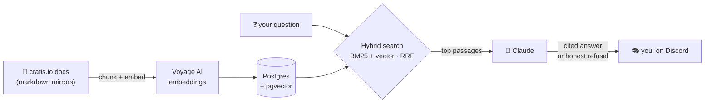

<div align="center">

# 🎭 Prompter

Cratis Prompter is a Discord docs assistant that answers Cratis community questions with citations.

**The Cratis community's docs assistant — living on Discord, grounded in the docs, allergic to making things up.**

[](https://discord.gg/kt4AMpV8WV)
[](https://hub.docker.com/r/cratis/prompter)
[](https://github.com/Cratis/Prompter/actions/workflows/build.yml)
[](https://github.com/Cratis/Prompter/actions/workflows/publish.yml)

</div>

---

In theater, the **prompter** sits just offstage with the script and quietly feeds the line to anyone who blanks
mid-scene. That's the whole idea. The script is the published documentation at
[cratis.io](https://www.cratis.io); the stage is the Cratis Discord; and when someone forgets their line —
*"wait, how do I append an event again?"* — Prompter whispers the answer, **with citations**, or admits
honestly when the docs don't cover it.

It is built to stick to the script: answers come from the retrieved docs, with citations — and when the docs
don't cover something, it says so instead of improvising.

## 🎭 Why "Prompter"?

Three reasons, and they all line up:

- **The theater prompter** feeds you the line you forgot from just offstage — never stealing the scene, always
  working from the script. That's exactly the role: the docs are the script, and the bot only speaks when
  someone needs the line.
- **The LLM double meaning** — Prompter *prompts* a language model for a living. The name wears its
  machinery on its sleeve.
- **The Cratis storytelling family** — Cratis names its products after telling a story: **Chronicle** records
  what happened, **Arc** shapes the plot, **Narrator**, **Lens**, **Studio**… **Prompter** joins the cast.

## 💬 What a scene looks like

```text
you  ·  #help
  How do I define a command in Arc?

🎭 Prompter  ·  replies to you
  In Arc a command is a record marked [Command]; its Handle() method
  returns the event(s) that happened — one file, backend to event:

    [Command]
    public record RegisterAuthor(AuthorId Id, AuthorName Name)
    {
        public AuthorRegistered Handle() => new(Name);
    }

  Arc then generates the TypeScript proxy so React calls it type-safe.

  📚 Sources
   • Cratis — One feature, one slice, typed end to end (cratis.io)

  👍  👎        ← tell us if that helped
```

Ask it about something the docs *don't* cover and it won't improvise — it tells you it doesn't know and points
you at a human. That honesty is the feature.

## ✨ How to summon it

- **@mention** `@Prompter` anywhere it can see — it replies in-thread, right where you asked.
- **`/ask`** — the slash command, for a clean one-off question; it shows a "thinking…" indicator while it
  looks things up, then delivers the cited answer.
- **`#ask-ai`** — a dedicated channel where every message is treated as a question, no mention needed.
- **Help forum** — open a new thread in the help forum and Prompter takes the first swing automatically, so
  you're never waiting on the timezone gods for a first answer.
- **👍 / 👎 buttons** — one click under any answer; the verdict is logged so the docs (and the bot) get better.
- **`/issue`** — turn what you are describing into a GitHub issue on the right Cratis repository: Prompter
  drafts it, shows it to you privately, and files it only when you say so. Bugs, missing APIs, feature
  requests, ideas, docs gaps — anything worth tracking.

> Prompter never barges into normal conversation — it only speaks when spoken to, and it rate-limits each
> person to a handful of questions per window so no one can spam it.

## 🧠 How it works

A small, honest RAG pipeline — hybrid retrieval (keyword **and** meaning), then a grounded answer with
citations:



- **Ingest** — walk cratis.io's sitemap, fetch each page's markdown mirror, strip the MDX noise, and split
  into heading-aware chunks. Only changed chunks are re-embedded, so re-indexing is cheap.
- **Retrieve** — one SQL query fuses lexical (BM25 via `tsvector`) and semantic (cosine over pgvector) hits
  with Reciprocal Rank Fusion.
- **Answer** — Claude gets the top passages and a system prompt that demands grounding and citations, and
  refuses when the score says the docs don't have it.

Built with **C# / .NET 10**, [NetCord](https://netcord.dev),
[Microsoft.Extensions.AI](https://learn.microsoft.com/en-us/dotnet/ai/), **Claude** (Anthropic), **Voyage AI**
embeddings, and **Postgres + pgvector**.

## 🚀 Quick start

Bring up Postgres (with pgvector):

```bash
docker compose up -d
```

Index the documentation, then ask a question straight from your terminal:

```bash
cd Source
dotnet run -- index                                        # ingest cratis.io into the corpus
dotnet run -- ask "How do I append an event in Chronicle?" # answer from the CLI (add --verbose for the passages)
```

Run it as the Discord bot — bot mode also serves `GET /healthz` and the shared-secret `POST /reindex`
in-cluster/local endpoint, and sweeps expired interactions on a daily retention job. Production re-indexes
nightly and on demand via the **Reindex - Production** workflow, without a public route:

```bash
dotnet run
```

Measure answer quality against the golden question set (from the repo root; needs the keys plus an indexed corpus):

```bash
dotnet run --project Eval                                   # groundedness, citation, and refusal scores
```

> You'll need a (free) **Voyage** API key to index and an **Anthropic** key to answer — see the table below.

## ⚙️ Configuration

Configuration binds to the `Cratis:Prompter` section (environment variables use `__` as the delimiter):

| Setting | Environment variable | Default |
|---|---|---|
| Postgres connection string | `Cratis__Prompter__ConnectionString` | localhost, db/user/pass `prompter` |
| Docs site to ingest | `Cratis__Prompter__DocsSiteUrl` | `https://cratis.io` |
| Embedding batch size | `Cratis__Prompter__Voyage__BatchSize` | `128` |
| Discord bot token | `Cratis__Prompter__Discord__Token` | — |
| Ask channel (mention-free questions) | `Cratis__Prompter__Discord__AskChannelId` | — |
| Help forum channel (auto-reply) | `Cratis__Prompter__Discord__HelpForumChannelId` | — |
| Rate limit — questions per window | `Cratis__Prompter__Discord__RateLimit__MaxQuestions` | `5` |
| Rate limit — window length (minutes) | `Cratis__Prompter__Discord__RateLimit__WindowMinutes` | `10` |
| Answer timeout (seconds) | `Cratis__Prompter__Discord__AnswerTimeoutSeconds` | `60` |
| Anthropic API key | `Cratis__Prompter__Anthropic__ApiKey` (or `ANTHROPIC_API_KEY`) | — |
| Default task model | `Cratis__Prompter__Anthropic__Model` | `claude-sonnet-5-5` |
| Optional secondary Anthropic key | `Cratis__Prompter__Anthropic__SecondaryApiKey` | — (disabled) |
| Provider-confirmed primary allocation reset | `Cratis__Prompter__Anthropic__PrimaryQuotaResetAt` | — |
| Answer model override | `Cratis__Prompter__Anthropic__Answer__Model` | default task model |
| Answer adaptive effort | `Cratis__Prompter__Anthropic__Answer__Effort` | `high` |
| Answer output-token ceiling (includes thinking) | `Cratis__Prompter__Anthropic__Answer__MaxOutputTokens` | `4096` |
| Answer provider deadline (seconds, max 60) | `Cratis__Prompter__Anthropic__Answer__TimeoutSeconds` | `60` |
| Answer secondary-account opt-in | `Cratis__Prompter__Anthropic__Answer__AllowSecondary` | `false` |
| Issue-draft model override | `Cratis__Prompter__Anthropic__IssueDraft__Model` | default task model |
| Haiku issue-draft evaluation approval | `Cratis__Prompter__Anthropic__HaikuIssueDraftApproved` | `false` |
| Voyage retries / indexing retries (max 3 / 5) | `Cratis__Prompter__Voyage__MaxRetries` / `Cratis__Prompter__Voyage__IndexMaxRetries` | `3` / `5` |
| Voyage deadline / indexing deadline (seconds, max 60 / 120) | `Cratis__Prompter__Voyage__TimeoutSeconds` / `Cratis__Prompter__Voyage__IndexTimeoutSeconds` | `60` / `120` |
| Refusal threshold (min top-passage score) | `Cratis__Prompter__Answering__MinScore` | `0.02` |
| Voyage API key | `Cratis__Prompter__Voyage__ApiKey` | — |
| Interaction retention (days) | `Cratis__Prompter__RetentionDays` | `90` |
| Re-index webhook secret | `Cratis__Prompter__ReindexSecret` | — |
| GitHub token (file issues) | `Cratis__Prompter__GitHub__Token` | — |
| GitHub webhook secret (answer issues) | `Cratis__Prompter__GitHub__WebhookSecret` | — |
| Repositories whose issues may be answered | `Cratis__Prompter__GitHub__AnsweringRepositories__0` | — (none) |
| Channel new issues are announced in | `Cratis__Prompter__GitHub__NotifyChannelId` | — |
| Label put on issues filed from Discord | `Cratis__Prompter__GitHub__IssueLabel` | `from-discord` |
| Label that opts an issue out of answers | `Cratis__Prompter__GitHub__OptOutLabel` | `no-prompter` |

API keys are never committed — use environment variables or a git-ignored `Source/appsettings.Development.json`.

Generation uses Sonnet 5.5 with adaptive thinking, explicit effort, no temperature/top-p/top-k, at most two
attempts and one shared task deadline. `Answer` and `IssueDraft` each support `Model`, `Effort` (`low`,
`medium`, `high`, or empty to omit thinking), `MaxOutputTokens` (max 4096), `MaxPromptTokens` (max 32000,
conservative UTF-8 byte bound), `TimeoutSeconds`, and `AllowSecondary`. Account fallback never changes the
model. Haiku 5.5 is only accepted for issue drafting after task-specific quality/cost/latency evaluation,
explicit `HaikuIssueDraftApproved=true`, and empty `IssueDraft:Effort`. It is not enabled by default.
Validate configured model availability and account entitlement before activating any deployment; offline
wire specs validate request shape, not provider availability or answer quality.

Secondary dispatch additionally requires an installed `IProviderAccounting` implementation reserving each
attempt against shared global/task budgets and independent provider/account caps. Without that integration,
existing primary-only dispatch remains available but secondary use fails closed. Only a provider-confirmed
primary monthly allocation exhaustion, configured with its actual future reset timestamp, can select the
secondary account. Generic 429s, auth/billing restrictions and unknown failures never switch identities;
503/529 overloads retry the same account. Do not use the reset setting to bypass unpaid balances, bans,
fraud restrictions or provider-wide capacity limits. Runtime account-specific error classification remains
disabled until documented structured evidence is available.

Voyage honors `Retry-After` seconds/dates, otherwise uses jittered exponential backoff, and shares a
key-scoped cooldown across query/index work. A cooldown exceeding the task deadline fails without an early
retry. Accounting hooks reconcile measured tokens; failed or canceled attempts retain unknown exposure,
not zero usage. Hooks carry fixed provider/account/task labels and no prompts, answers, keys or error bodies.

## 🗺️ Start here (for contributors)

- [`Deployment/README.md`](Deployment/README.md) — the Pulumi stack that runs Prompter on the shared Cratis UpCloud cluster.
- [`Documentation/concepts/architecture.md`](Documentation/concepts/architecture.md) — how ingestion, retrieval, and answering fit together.

## ✅ Quality gates

```bash
dotnet build --configuration Release   # zero warnings, zero errors (warnings are errors in Release)
dotnet test  --configuration Release   # all specs green
```

And one more gate that's unusual for a bot: **answer quality is measured, not vibed.** A golden-question eval
harness (milestone M4) scores groundedness, citation accuracy, and refusal behavior — and gates prompt and
retrieval changes the same way specs gate code.

## The Cratis ecosystem

This project is part of [Cratis](https://www.cratis.io) — free, MIT-licensed tools for building event-sourced and CQRS applications.

- **[Chronicle](https://github.com/Cratis/Chronicle)** — event-sourcing database and runtime. Orleans-based kernel, pluggable storage (MongoDB default; PostgreSQL, SQL Server, SQLite, in-memory), language-agnostic gRPC contracts. [Docs](https://www.cratis.io/chronicle/)
- **Chronicle clients** — first-class [.NET SDK](https://github.com/Cratis/Chronicle), plus [TypeScript](https://github.com/Cratis/Chronicle.TypeScript), [Kotlin/Java](https://github.com/Cratis/Chronicle.Kotlin), and [Elixir](https://github.com/Cratis/Chronicle.Elixir); [Python](https://github.com/Cratis/Chronicle.Python) coming soon (pre-alpha). AI agents connect through the [Chronicle MCP server](https://github.com/Cratis/Chronicle.Mcp).
- **[Arc](https://github.com/Cratis/Arc)** — opinionated CQRS framework for ASP.NET Core with commands, queries, validation, authorization, and TypeScript proxy generation. Works without event sourcing. [Docs](https://www.cratis.io/arc/)
- **[Components](https://github.com/Cratis/Components)** — React components aligned with Arc patterns. [Docs](https://www.cratis.io/components/)
- **[CLI](https://github.com/Cratis/cli) + Workbench** — inspect and diagnose Chronicle from the terminal or the browser. [Docs](https://www.cratis.io/cli/)
- **Model-first layer (experimental)** — [Studio](https://github.com/Cratis/Studio), [Screenplay](https://github.com/Cratis/Screenplay), [Stage](https://github.com/Cratis/Stage), [Scene](https://github.com/Cratis/Scene), [Prologue](https://github.com/Cratis/Prologue)
- **Supporting** — [Fundamentals](https://github.com/Cratis/Fundamentals), [Specifications](https://github.com/Cratis/Specifications), [Synopsis](https://github.com/Cratis/Synopsis), [Lens](https://github.com/Cratis/Lens), [Narrator](https://github.com/Cratis/Narrator), and free [AI tooling](https://github.com/Cratis/AI) (preview); [Ensemble](https://github.com/Cratis/Ensemble) coming soon (pre-release)
- **[Samples](https://github.com/Cratis/Samples)** — runnable event sourcing and CQRS samples for the whole stack

Everything Cratis publishes today is MIT licensed and free to use.

---

<div align="center">

*Part of the [Cratis](https://www.cratis.io) platform · Licensed under the [MIT license](LICENSE)*

</div>
