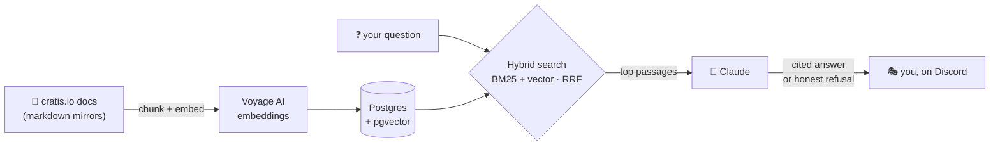

<div align="center">

# 🎭 Prompter

Cratis Prompter is a Discord docs assistant that answers Cratis community questions with citations.

**The Cratis community's docs assistant — living on Discord, grounded in the docs, allergic to making things up.**

[](https://discord.gg/kt4AMpV8WV)
[](https://hub.docker.com/r/cratis/prompter)
[](https://github.com/Cratis/Prompter/actions/workflows/build.yml)
[](https://github.com/Cratis/Prompter/actions/workflows/publish.yml)

</div>

---

In theater, the **prompter** sits just offstage with the script and quietly feeds the line to anyone who blanks
mid-scene. That's the whole idea. The script is the published documentation at
[cratis.io](https://www.cratis.io); the stage is the Cratis Discord; and when someone forgets their line —
*"wait, how do I append an event again?"* — Prompter whispers the answer, **with citations**, or admits
honestly when the docs don't cover it.

It is built to stick to the script: answers come from the retrieved docs, with citations — and when the docs
don't cover something, it says so instead of improvising.

## 🎭 Why "Prompter"?

Three reasons, and they all line up:

- **The theater prompter** feeds you the line you forgot from just offstage — never stealing the scene, always
  working from the script. That's exactly the role: the docs are the script, and the bot only speaks when
  someone needs the line.
- **The LLM double meaning** — Prompter *prompts* a language model for a living. The name wears its
  machinery on its sleeve.
- **The Cratis storytelling family** — Cratis names its products after telling a story: **Chronicle** records
  what happened, **Arc** shapes the plot, **Narrator**, **Lens**, **Studio**… **Prompter** joins the cast.

## 💬 What a scene looks like

```text
you  ·  #help
  How do I define a command in Arc?

🎭 Prompter  ·  replies to you
  In Arc a command is a record marked [Command]; its Handle() method
  returns the event(s) that happened — one file, backend to event:

    [Command]
    public record RegisterAuthor(AuthorId Id, AuthorName Name)
    {
        public AuthorRegistered Handle() => new(Name);
    }

  Arc then generates the TypeScript proxy so React calls it type-safe.

  📚 Sources
   • Cratis — One feature, one slice, typed end to end (cratis.io)

  👍  👎        ← tell us if that helped
```

Ask it about something the docs *don't* cover and it won't improvise — it tells you it doesn't know and points
you at a human. That honesty is the feature.

## ✨ How to summon it

- **@mention** `@Prompter` anywhere it can see — it replies in-thread, right where you asked.
- **`/ask`** — the slash command, for a clean one-off question; it shows a "thinking…" indicator while it
  looks things up, then delivers the cited answer.
- **`#ask-ai`** — a dedicated channel where every message is treated as a question, no mention needed.
- **Help forum** — open a new thread in the help forum and Prompter takes the first swing automatically, so
  you're never waiting on the timezone gods for a first answer.
- **👍 / 👎 buttons** — one click under any answer; the verdict is logged so the docs (and the bot) get better.
- **`/issue`** — turn what you are describing into a GitHub issue on the right Cratis repository: Prompter
  drafts it, shows it to you privately, and files it only when you say so. Bugs, missing APIs, feature
  requests, ideas, docs gaps — anything worth tracking.

> Prompter never barges into normal conversation — it only speaks when spoken to, and it rate-limits each
> person to a handful of questions per window so no one can spam it.

## 🧠 How it works

A small, honest RAG pipeline — hybrid retrieval (keyword **and** meaning), then a grounded answer with
citations:



- **Ingest** — walk cratis.io's sitemap, fetch each page's markdown mirror, strip the MDX noise, and split
  into heading-aware chunks. Published GitHub release notes and curated Cratis samples join the same
  corpus. Only changed chunks are re-embedded, so re-indexing is cheap.
- **Retrieve** — one SQL query fuses lexical (BM25 via `tsvector`) and semantic (cosine over pgvector) hits
  with Reciprocal Rank Fusion (RRF), used only for ordering.
- **Answer** — only passages meeting an independent cosine-similarity cutoff reach Claude and citation
  selection. With no qualifying passage, Prompter refuses without calling Claude. The system prompt
  still treats excerpts as untrusted data and demands grounding and citations; relevance is not trust.

Built with **C# / .NET 10**, [NetCord](https://netcord.dev),
[Microsoft.Extensions.AI](https://learn.microsoft.com/en-us/dotnet/ai/), **Claude** (Anthropic), **Voyage AI**
embeddings, and **Postgres + pgvector**.

## Conversation context and privacy

For mentions, the dedicated ask channel, and help-forum answers, Prompter can send recent public
conversation text to its model provider to clarify follow-up questions. The latest question alone drives
documentation retrieval; only retrieved documentation is evidence, never earlier messages or bot claims.
`/ask`, CLI questions, and evaluations remain single-question requests.

History is limited to **10 preceding messages**, **15 minutes**, and **6,000 characters** in the same
public channel or thread. The current question is kept separately, with a **4,000-character** ceiling.
Admission, duplicate/rate checks, concurrency, and spend reservation all precede history reads.
Missing permissions, unavailable history, a one-second history deadline, or cancellation discard history
and leave a current-only request with a degraded-context flag.

No DMs, private threads, parent/sibling message scans, attachments, embeds, linked pages, or other bots'
messages are read as context. The bot's own earlier text may be included as untrusted assistant context.
Author names and IDs are not sent as metadata; mentions and obvious secret-like strings are removed
from message text. This filtering cannot guarantee anonymity or detect every secret: do not post
sensitive information in public conversations. Context is held only for the request, not stored in the
corpus, interaction log, caches, feedback, or diagnostics. Existing aggregate interaction records do not
contain question or conversation text.

## 🚀 Quick start

Bring up Postgres (with pgvector):

```bash
docker compose up -d
```

Index the documentation, then ask a question straight from your terminal:

```bash
cd Source
dotnet run -- index                                        # ingest cratis.io into the corpus
dotnet run -- ask "How do I append an event in Chronicle?" # answer from the CLI (add --verbose for the passages)
```

Run it as the Discord bot — bot mode also serves `GET /healthz` and the shared-secret `POST /reindex`
in-cluster/local endpoint, and sweeps expired interactions on a daily retention job. Production re-indexes
daily at 03:52 UTC once `PROMPTER_SCHEDULED_INDEXING_ENABLED` is set to `true`, and on demand via the
**Reindex - Production** workflow, without a public route. Documentation changes never trigger reindexing.
All entry points share a non-waiting Postgres advisory lease. A complete crawl and retry-inclusive
UTF-8 byte/token budget check precede embedding; a failed batch or crawl leaves the last-good corpus intact.
Plain `index` is incremental. A manual full replacement requires
`index --full '--confirm-full-reindex=FULL REINDEX'`; scheduled full runs are forbidden.
The authenticated HTTP equivalent is `POST /reindex?full=true` with `X-Reindex-Confirmation: FULL REINDEX`.
HTTP acceptance is asynchronous; database contention or budget rejection is recorded as a failed run in logs.
Configure a verified Voyage price and positive run/day dollar ceilings before embedding changed content:


```bash
dotnet run
```

Measure answer quality against the golden question set (from the repo root; needs the keys plus an indexed corpus):

```bash
dotnet run --project Eval                                   # groundedness, citation, and refusal scores
```

> You'll need a **Voyage** API key and verified indexing price/dollar ceilings to index, and an **Anthropic** key to answer — see the table below.

## Release notes and curated samples

Indexing includes public, unauthenticated GitHub reads alongside cratis.io documentation:

- **Release notes** — the latest 20 releases per repository for Chronicle, Arc, Fundamentals, Components,
  and cli. Drafts, prereleases, empty bodies, and bodies over 20,000 characters are excluded. Explicit
  release tags and publication dates supply version and freshness metadata. Citations retain the full
  release URL and show `release notes` before any provenance note.
- **Samples** — up to 300 files, each at most 16,384 bytes, from `Cratis/Samples` on `main`, fetched in
  ordinal path order. The curated paths are root `README.md`, `LearningPath/**/README.md` and
  `LearningPath/**/*.cs`, README files under Chronicle, Arc, EventModeling, ModelFirst, and GeneratedValues,
  and the Capstone and Library root READMEs. Path globs are case-sensitive; `**` spans zero or more
  directories. Citations retain GitHub blob URLs (including `.md`) and show `sample`.

Samples always exclude dot directories, bin/obj/node_modules, generated paths, `.g.cs`, `.Designer.cs`,
appsettings files, `.env`, `.pfx`, `.pem`, `.key`, and `.snk` files. Secret-shaped content is excluded before
embedding; diagnostics contain only its path, never matched contents. This defense is conservative, not a
promise to detect every secret. Code is wrapped in language-tagged fences longer than any backtick run
inside the file. Source kind is derived from the URL; no schema migration or separate corpus is needed.

A GitHub error, rate limit, timeout, malformed response, truncated tree, or failed raw-file fetch fails the
whole index run before pruning; the previous corpus remains available. All sources share the existing
embedding budgets. These sources use a public User-Agent and GitHub Accept header, never the issue-writing
token. To restore docs-only ingestion, set both `Cratis__Prompter__Ingestion__ReleaseNotes__Enabled=false`
and `Cratis__Prompter__Ingestion__Samples__Enabled=false`.

## ⚙️ Configuration

Configuration binds to the `Cratis:Prompter` section (environment variables use `__` as the delimiter):

| Setting | Environment variable | Default |
|---|---|---|
| Postgres connection string | `Cratis__Prompter__ConnectionString` | localhost, db/user/pass `prompter` |
| Docs site to ingest | `Cratis__Prompter__DocsSiteUrl` | `https://cratis.io` |
| Embedding batch size | `Cratis__Prompter__Voyage__BatchSize` | `128` |
| Include release notes | `Cratis__Prompter__Ingestion__ReleaseNotes__Enabled` | `true` |
| Release repositories (indexed array) | `Cratis__Prompter__Ingestion__ReleaseNotes__Repositories__0` (and subsequent indices) | `Chronicle`, `Arc`, `Fundamentals`, `Components`, `cli` |
| Releases per repository | `Cratis__Prompter__Ingestion__ReleaseNotes__MaxReleasesPerRepository` | `20` |
| Maximum release body characters | `Cratis__Prompter__Ingestion__ReleaseNotes__MaxBodyCharacters` | `20000` |
| Include curated samples | `Cratis__Prompter__Ingestion__Samples__Enabled` | `true` |
| Sample repository | `Cratis__Prompter__Ingestion__Samples__Repository` | `Cratis/Samples` |
| Sample branch | `Cratis__Prompter__Ingestion__Samples__Branch` | `main` |
| Sample allowlist (indexed array) | `Cratis__Prompter__Ingestion__Samples__Paths__0` (and subsequent indices) | Curated paths above |
| Maximum sample file bytes | `Cratis__Prompter__Ingestion__Samples__MaxFileBytes` | `16384` |
| Maximum sample files | `Cratis__Prompter__Ingestion__Samples__MaxFiles` | `300` |
| Incremental token ceiling (including retries) | `Cratis__Prompter__Ingestion__MaxIncrementalTokens` | `1000000` |
| Confirmed full token ceiling (including retries) | `Cratis__Prompter__Ingestion__MaxFullTokens` | `25000000` |
| Verified model price per million tokens | `Cratis__Prompter__Ingestion__PricePerMillionTokens` | `0` (paid indexing disabled) |
| Index dollar ceiling per run | `Cratis__Prompter__Ingestion__MaxRunDollars` | `0` (paid indexing disabled) |
| Shared index dollar ceiling per UTC day | `Cratis__Prompter__Ingestion__MaxDailyDollars` | `0` (paid indexing disabled) |
| Discord bot token | `Cratis__Prompter__Discord__Token` | — |
| Ask channel (mention-free questions) | `Cratis__Prompter__Discord__AskChannelId` | — |
| Help forum channel (auto-reply) | `Cratis__Prompter__Discord__HelpForumChannelId` | — |
| Answer-in-thread channels (off when empty) | `Cratis__Prompter__Discord__AnswerInThreadChannelIds__0` | — |
| Maintainer role for Ask a human (off when unset) | `Cratis__Prompter__Discord__MaintainerRoleId` | — |
| Rate limit — questions per window | `Cratis__Prompter__Discord__RateLimit__MaxQuestions` | `5` |
| Rate limit — window length (minutes) | `Cratis__Prompter__Discord__RateLimit__WindowMinutes` | `10` |
| Answer timeout (seconds) | `Cratis__Prompter__Discord__AnswerTimeoutSeconds` | `60` |
| Anthropic API key | `Cratis__Prompter__Anthropic__ApiKey` (or `ANTHROPIC_API_KEY`) | — |
| Default task model | `Cratis__Prompter__Anthropic__Model` | `claude-sonnet-5-5` |
| Optional secondary Anthropic key | `Cratis__Prompter__Anthropic__SecondaryApiKey` | — (disabled) |
| Provider-confirmed primary allocation reset | `Cratis__Prompter__Anthropic__PrimaryQuotaResetAt` | — |
| Answer model override | `Cratis__Prompter__Anthropic__Answer__Model` | `claude-haiku-5-5` (priced by `Protection__AnthropicAnswer__*`; default input `0.20` worst cache-write, output `0.50` USD per million) |
| Answer adaptive effort | `Cratis__Prompter__Anthropic__Answer__Effort` | empty (none) |
| Answer output-token ceiling  | `Cratis__Prompter__Anthropic__Answer__MaxOutputTokens` | `768` |
| Answer provider deadline (seconds, max 60) | `Cratis__Prompter__Anthropic__Answer__TimeoutSeconds` | `60` |
| Answer secondary-account opt-in | `Cratis__Prompter__Anthropic__Answer__AllowSecondary` | `false` |
| Issue-draft model override | `Cratis__Prompter__Anthropic__IssueDraft__Model` | default task model |
| Haiku issue-draft evaluation approval | `Cratis__Prompter__Anthropic__HaikuIssueDraftApproved` | `false` |
| Voyage retries / indexing retries (max 3 / 5) | `Cratis__Prompter__Voyage__MaxRetries` / `Cratis__Prompter__Voyage__IndexMaxRetries` | `3` / `5` |
| Voyage deadline / indexing deadline (seconds, max 60 / 120) | `Cratis__Prompter__Voyage__TimeoutSeconds` / `Cratis__Prompter__Voyage__IndexTimeoutSeconds` | `60` / `120` |
| Minimum cosine similarity for every grounding passage | `Cratis__Prompter__Answering__MinSemanticSimilarity` | `0.5` (uncalibrated initial policy; finite cutoff in `(0, 1]`) |
| Voyage API key | `Cratis__Prompter__Voyage__ApiKey` | — |
| Interaction retention (days) | `Cratis__Prompter__RetentionDays` | `90` |
| Re-index webhook secret | `Cratis__Prompter__ReindexSecret` | — |
| GitHub token (file issues) | `Cratis__Prompter__GitHub__Token` | — |
| GitHub webhook secret (answer issues) | `Cratis__Prompter__GitHub__WebhookSecret` | — |
| Repositories whose issues may be answered | `Cratis__Prompter__GitHub__AnsweringRepositories__0` | — (none) |
| Channel new issues are announced in | `Cratis__Prompter__GitHub__NotifyChannelId` | — |
| Anonymous public related-issue links (off switch) | `Cratis__Prompter__GitHub__PublicRelatedIssuesEnabled` | `true` |
| Label put on issues filed from Discord | `Cratis__Prompter__GitHub__IssueLabel` | `from-discord` |
| Label that opts an issue out of answers | `Cratis__Prompter__GitHub__OptOutLabel` | `no-prompter` |
| Maintainer channel (weekly metadata-only gap digest) | `Cratis__Prompter__Discord__MaintainerChannelId` | — (digest off) |
| Weekly digest UTC day | `Cratis__Prompter__Discord__MaintainerDigestDay` | `Monday` |
| Weekly digest UTC hour (clamped to 0–23) | `Cratis__Prompter__Discord__MaintainerDigestHourUtc` | `8` |

API keys are never committed — use environment variables or a git-ignored `Source/appsettings.Development.json`.

### Retrieval policy and migration

**Operator migration:** `Cratis__Prompter__Answering__MinScore` is retired and ignored, including
existing overrides. Configure `Cratis__Prompter__Answering__MinSemanticSimilarity` explicitly instead;
**do not reuse or numerically translate the old `0.02` RRF threshold**. The deployment projection
explicitly sets the new cutoff to `0.5`; normal CLI options binding also defaults to `0.5`. This
changes observable answer/refusal behavior, not just the option name.

RRF retains hybrid ordering. Every admitted passage must have finite cosine similarity in `[-1, 1]`
meeting the new cutoff; weak, invalid and lexical-only low-similarity candidates cannot enter answer
context or citations. All-empty or all-rejected retrieval refuses without a chat call. Verbose CLI
output labels `rrf` and `semantic similarity` separately. Successful `Answer.Confidence` and new
interaction confidence values mean the RRF-first admitted passage's cosine similarity; on refusal,
the value is the highest valid candidate similarity, or zero for no valid candidates. Existing stored
interaction values retain their historical RRF meaning and must not be compared as one distribution.
None of these numbers is an answer-correctness probability or a trust boundary.

The initial **0.5 is uncalibrated policy**, not a measured Voyage quality/recall guarantee. Synthetic
positive, orthogonal, weak-similarity and lexical-only fixtures verify the implementation, not
production answerability. Production acceptance remains unverified until separately authorized,
bounded live positive and negative acceptance evidence exists. A failed positive acceptance is a
stop, not permission to lower the cutoff or repeat paid calls. Filtering remains after the existing
top-eight retrieval limit; this change does not widen recall or alter lexical query parsing.

### Admission and spend protection

`Cratis:Prompter:Protection` applies before history, retrieval, model dispatch or GitHub drafting.
Bot mode requires `AllowedGuilds`: the empty default refuses every guild and all DMs.
Production must explicitly set `Cratis__Prompter__Protection__AllowedGuilds__0=1182595891576717413`.
Within an allowed guild, mentions still work in readable channels, alongside the configured ask
channel and help forum. `DeniedChannels` optionally excludes channel/thread IDs.

Defaults: 3 simultaneous paid answers (no queue), 60 admissions/hour globally, 20/hour per
channel/thread, and the existing 5/user/10 minutes. Current questions are capped at 4,000 characters;
normalized duplicates from the same user/channel are suppressed for 2 minutes. Limit replies are
restricted to one/user/10 minutes and one/channel/minute; excess requests are ignored silently.
Only keyed hashes are kept in bounded expiring memory caches; rate limits reset on restart.
The existing 60-second answer deadline also covers drafting, reservation and forum starter fetching.

The **shared $5/UTC-day ceiling is durable**, including CLI indexing, retries and concurrent processes.
Each answer reserves its worst-case Anthropic input/output and Voyage retry exposure atomically,
beneath both the global ceiling and provider `DailyUsd` sublimits. Anthropic SDK retries are disabled;
Voyage attempts are charged inside the existing retry policy. A restart, timeout, missing usage or
failed settlement never releases ambiguous exposure. Known plain chat usage is reconciled;
cache-related/extra usage counters and embedding attempts conservatively retain their upper exposure.
Spend tables contain only UTC days, anonymous reservation UUIDs, provider dollar amounts and settlement
state — no Discord IDs or text. The additive `v1_3_0.sql` migration runs at normal schema initialization.
Old binaries ignore these tables **and bypass the new ceiling**: stop old paid workers before rollout.

Before enabling paid work, explicitly configure **both** `Protection:Anthropic` and
`Protection:Voyage`: `Model` (exact configured provider model), `InputUsdPerMillion`,
`MaxInputTokens` (verified hard model ceiling), and `DailyUsd` (default $5 per provider beneath the
shared ceiling). Anthropic also requires `OutputUsdPerMillion`. Use conservative current prices,
including the highest applicable cache-write input price. Prices default to unverified, not guessed:
missing/mismatched pricing or an unavailable ledger refuses dispatch. Large indexing batches may
need smaller existing indexing batch settings to fit the verified Voyage input bound and remaining spend.

`Protection:AnsweringEnabled`, `IndexingEnabled` and `GitHubWritesEnabled` all default to `true`.
Set the corresponding environment setting to `false` and restart to stop new answers/drafts,
indexing, or GitHub operations respectively. These switches do not revoke already-issued provider calls.
Webhook bodies, including chunked bodies, are capped at 65,536 bytes (`WebhookBytes`).

For isolated ledger specs, supply only the loopback port of a disposable, trust-authenticated
Postgres instance in `PROMPTER_LEDGER_TEST_PORT` and run `./Specs/bin/Release/net10.0/Prompter.Specs`.
Without that opt-in, the Postgres integration spec is explicitly skipped; all other protection specs
are offline. Never point this probe at a live database: it creates and drops a random test schema.

### Provider resilience and task policies

Generation uses Sonnet 5.5 with adaptive thinking, explicit effort, no temperature/top-p/top-k, at most two
attempts and one shared task deadline. `Answer` and `IssueDraft` each support `Model`, `Effort` (`low`,
`medium`, `high`, or empty to omit thinking), `MaxOutputTokens` (max 4096), `MaxPromptTokens` (max 32000,
conservative UTF-8 byte bound), `TimeoutSeconds`, `PreferredAccount` (`primary` or `secondary`), and
`AllowSecondary`. Account selection never changes the
model. Haiku 5.5 is only accepted for issue drafting after task-specific quality/cost/latency evaluation,
explicit `HaikuIssueDraftApproved=true`, and empty `IssueDraft:Effort`. It is not enabled by default.
Production protection requires verified pricing and durable funding before every transport attempt.
The first chat attempt claims the interactive prepaid lease without charging the daily ledger twice;
the one permitted retry reserves its own conservative exposure against the same UTC-day ceiling.
Voyage query attempts claim their bounded prepaid retry envelope; indexing attempts reserve independently.
Duplicate or mismatched permits, exhausted funding, and database failures deny transport. Failed, canceled,
missing, cached/additional, or inconsistent usage retains its full bound. Only fully known usage can refund
exposure after durable completion; cleanup has an independent five-second deadline.
Validate configured model availability and account entitlement before activating any deployment; offline
wire specs validate request shape, not provider availability or answer quality.

Production registers Postgres-backed `IProviderAccounting` as required composition. Secondary selection
requires that accounting, an available secondary client, task-specific `AllowSecondary=true`, and explicit
`PreferredAccount=secondary`. The legacy provider-confirmed primary allocation reset setting remains
compatible, but no reset is manufactured. Unknown account values fail closed. Both keys share the same
global and provider daily caps, not separate dollar pools. Generic 429s, auth/billing restrictions and unknown failures never switch identities;
503/529 overloads retry the same account. Do not use the reset setting to bypass unpaid balances, bans,
fraud restrictions or provider-wide capacity limits. Runtime account-specific error classification remains
disabled until documented structured evidence is available.

Voyage honors `Retry-After` seconds/dates, otherwise uses jittered exponential backoff, and shares a
key-scoped cooldown across query/index work. A cooldown exceeding the task deadline fails without an early
retry. Accounting hooks reconcile measured tokens; failed or canceled attempts retain unknown exposure,
not zero usage. Hooks carry fixed provider/account/task labels and no prompts, answers, keys or error bodies.

### Offline-ready deployment configuration

The Pulumi stack projects verified standard-global Sonnet 5.5 and Voyage 4 prices. Defaults keep both paid
workloads disabled. The committed production settings explicitly enable secondary-account answering only
for guild `1182595891576717413`; indexing remains disabled in the bot pod. Scheduled indexing Jobs run
only when the repository variable `PROMPTER_SCHEDULED_INDEXING_ENABLED` is `true`.
These are desired configuration settings, not evidence of deployment or live usability.

Non-secret `prompter-deployment` settings `answeringEnabled` and `indexingEnabled` control paid workloads.
`answerPreferredAccount` / `issueDraftPreferredAccount` default to `primary`;
`answerAllowSecondary` / `issueDraftAllowSecondary` default to `false` and are separate workload opt-ins.
`allowedGuilds` defaults to empty and may contain only the approved guild. Deployment rejects unknown
accounts, unauthorized guilds, and enabled secondary selection without task opt-in. Startup additionally
requires a nonempty secondary key for each selected secondary task, without checking provider eligibility
or logging the key.
The explicit scalar `Cratis__Prompter__Protection__ConfiguredAllowedGuilds` replaces the entire effective
guild list after binding, so lower-priority indexed defaults cannot add guilds; indexed `AllowedGuilds__0`
is also emitted. Enabled answering without an explicit approved allowlist fails startup.
Do not select secondary to evade provider restrictions, and do not use this configuration as quota evidence.

The shared daily ceiling is $5. Sonnet input reserves $4/MTok (the highest applicable one-hour cache-write
rate), output including thinking $10/MTok; unknown cache shape does not receive a refund. Voyage 4 reserves
$0.06/MTok with 1024 dimensions. Both local input ceilings are 32,000 UTF-8 bytes/tokens, stricter than
Sonnet's 1M context and Voyage's 320K/request; local output is 4096 tokens including thinking. These prices
cover standard global requests only, not US-only processing (1.1×) or other service tiers. No tools or
unbounded generation loops are enabled. Public references: [Sonnet overview](https://platform.claude.com/docs/en/models/sonnet-5-5/overview),
[Anthropic pricing](https://platform.claude.com/docs/en/about-claude/pricing),
[adaptive thinking](https://platform.claude.com/docs/en/build-with-claude/adaptive-thinking),
[Voyage embeddings](https://docs.voyageai.com/docs/embeddings), and [Voyage pricing](https://docs.voyageai.com/docs/pricing).

## 🗺️ Start here (for contributors)

- [`Deployment/README.md`](Deployment/README.md) — the Pulumi stack that runs Prompter on the shared Cratis UpCloud cluster.
- [`Documentation/concepts/architecture.md`](Documentation/concepts/architecture.md) — how ingestion, retrieval, and answering fit together.

## ✅ Quality gates

```bash
dotnet build --configuration Release          # zero warnings, zero errors (warnings are errors in Release)
./Specs/bin/Release/net10.0/Prompter.Specs    # all specs green (xUnit v3 executable, not dotnet test)
```

And one more gate that's unusual for a bot: **answer quality is measured, not vibed.** A golden-question eval
harness (milestone M4) scores groundedness, citation accuracy, and refusal behavior — and gates prompt and
retrieval changes the same way specs gate code.

## The Cratis ecosystem

This project is part of [Cratis](https://www.cratis.io) — free, MIT-licensed tools for building event-sourced and CQRS applications.

- **[Chronicle](https://github.com/Cratis/Chronicle)** — event-sourcing database and runtime. Orleans-based kernel, pluggable storage (MongoDB default; PostgreSQL, SQL Server, SQLite, in-memory), language-agnostic gRPC contracts. [Docs](https://www.cratis.io/chronicle/)
- **Chronicle clients** — first-class [.NET SDK](https://github.com/Cratis/Chronicle), plus [TypeScript](https://github.com/Cratis/Chronicle.TypeScript), [Kotlin/Java](https://github.com/Cratis/Chronicle.Kotlin), and [Elixir](https://github.com/Cratis/Chronicle.Elixir); [Python](https://github.com/Cratis/Chronicle.Python) coming soon (pre-alpha). AI agents connect through the [Chronicle MCP server](https://github.com/Cratis/Chronicle.Mcp).
- **[Arc](https://github.com/Cratis/Arc)** — opinionated CQRS framework for ASP.NET Core with commands, queries, validation, authorization, and TypeScript proxy generation. Works without event sourcing. [Docs](https://www.cratis.io/arc/)
- **[Components](https://github.com/Cratis/Components)** — React components aligned with Arc patterns. [Docs](https://www.cratis.io/components/)
- **[CLI](https://github.com/Cratis/cli) + Workbench** — inspect and diagnose Chronicle from the terminal or the browser. [Docs](https://www.cratis.io/cli/)
- **Model-first layer (experimental)** — [Studio](https://github.com/Cratis/Studio), [Screenplay](https://github.com/Cratis/Screenplay), [Stage](https://github.com/Cratis/Stage), [Scene](https://github.com/Cratis/Scene), [Prologue](https://github.com/Cratis/Prologue)
- **Supporting** — [Fundamentals](https://github.com/Cratis/Fundamentals), [Specifications](https://github.com/Cratis/Specifications), [Synopsis](https://github.com/Cratis/Synopsis), [Lens](https://github.com/Cratis/Lens), [Narrator](https://github.com/Cratis/Narrator), and free [AI tooling](https://github.com/Cratis/AI) (preview); [Ensemble](https://github.com/Cratis/Ensemble) coming soon (pre-release)
- **[Samples](https://github.com/Cratis/Samples)** — runnable event sourcing and CQRS samples for the whole stack

Everything Cratis publishes today is MIT licensed and free to use.

---

<div align="center">

*Part of the [Cratis](https://www.cratis.io) platform · Licensed under the [MIT license](LICENSE)*

</div>
